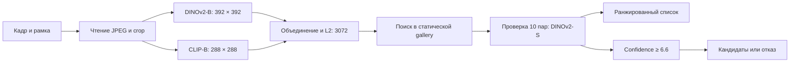

# Falcon ReID

**DeepTech AI · ЛЦТ 2026 · задача №7 «Фалькон Тех»**

Поиск одного автомобиля на снимках разных камер. На входе — изображения и рамки автомобилей; на выходе — ранжированные кандидаты, эмбеддинги и совпадения с оценкой уверенности либо отказ. Решение работает офлайн в Docker.

[Презентация PDF](presentation/Falcon_ReID_Defense.pdf) · [PPTX](presentation/Falcon_ReID_Defense.pptx) · [Видео, 1:55](presentation/demo.mp4) · [Веса](https://github.com/Timur713/hf_2026/releases/tag/fusion-pair-d065-20260927-rc1)

## Запуск

Нужны Linux x86-64, NVIDIA GPU, NVIDIA Container Toolkit и Docker Compose v2. Проверено на RTX A5000 24 ГБ и A10. Образ использует CUDA 12.1. Интернет нужен только при сборке: веса скачиваются из фиксированного релиза с проверкой SHA-256.

```bash
git clone https://github.com/Timur713/hf_2026.git
cd hf_2026
# Распакуйте предоставленный датасет в dataset/.
mkdir -p outputs
docker compose run --build --rm reid
```

Структура входных данных:

```text
dataset/
├── images/
├── test_query.csv
└── test_gallery.csv
```

CSV содержит `image_id,x,y,w,h`; координаты рамки заданы в пикселях полного кадра. Gallery должна содержать минимум 10 объектов. ID уникальны внутри каждого CSV. Метки `vehicle_id` и `camera_id` на инференсе не используются.

Другие пути можно задать переменными окружения:

```bash
DATA_ROOT=/absolute/path/dataset OUTPUT_ROOT=/absolute/path/results \
  QUERY_CSV=/data/query.csv GALLERY_CSV=/data/gallery.csv \
  docker compose run --rm reid
```

Каталоги должны существовать. Контейнер читает `/data` без права записи, сохраняет результат в `/out`; сеть отключена через `network_mode: none`. Повторный запуск перезаписывает выходные файлы.

## Результат

| Файл | Содержимое |
|---|---|
| `submission.csv` | Без заголовка: ID запроса и 10 различных ID gallery, в порядке входных запросов |
| `embeddings.npy` | Матрица float32 `(N_query + N_gallery, 3072)`: сначала запросы, затем gallery; векторы L2-нормированы |
| `candidates.csv` | `query_id,gallery_id,confidence`: три кандидата для принятого запроса; при отказе строк нет |

Confidence — оценка относительно распределения сходства в gallery, не вероятность. Порог применяется к верхнему кандидату; у двух следующих — убывающие ранговые оценки. В текущей оценке учитывается только верхний кандидат.

Полные результаты открытого теста сохранены в [submission/](submission/). Видео использует отдельный демонстрационный набор из 5 запросов и 636 объектов gallery и не является оценкой качества.

## Как устроено решение



Кадр декодируется один раз. После обрезки по рамке каждый encoder получает свой размер изображения: bilinear resize с antialias, нормализация из конфига модели. CLS и усреднение 16 выбранных patch-токенов дают по 1536 признаков. Взвешенная конкатенация нормируется до единичной длины.

Поиск использует cosine similarity и поправку на объекты gallery, похожие на слишком много других объектов. Парный verifier меняет порядок только внутри найденной десятки: к стандартизированной оценке поиска добавляется `0.15 × sigmoid(logit)`. Для выбранного первого кандидата вычисляется gallery-z; значение ниже **6.6** означает отказ.

Каждый запрос использует только своё изображение и статическую gallery. Нет query expansion, кластеризации запросов или нормализации по батчу запросов. Модели работают в `eval()`, CUDA forward использует FP16, итоговые векторы — float32. Номера не распознаются.

## Проверенные результаты

| Показатель | Значение | Условия |
|---|---:|---|
| mAP@10 | **0.852541** | Два OOF-фолда, сохранённые эмбеддинги и логиты verifier |
| 0.7 × F1 + 0.3 × TNR | **0.960470** | Те же фолды, порог 6.6 |
| Медиана extraction, batch=1 | **24.884 мс** | RTX A5000, чтение JPEG → L2 |
| Throughput | **102.674 FPS** | RTX A5000, batch=32, без поиска и verifier |
| Размер всех весов | **788 647 632 байта** | Два encoder и verifier; лимит 2 ГБ |

[Отчёт и исходные измерения](docs/results.md) объясняют протокол, выбор порога и ограничения. Это не метрики закрытого теста. Число качества по сохранённым эмбеддингам нельзя считать измерением качества полного Docker-пути.

Известные ограничения: похожие машины, смена ракурса, ночь и перекрытия; неполное покрытие номеров геометрической маской; небольшой численный дрейф confidence при смене размера батча. Подробности и непройденная строгая численная проверка сохранены в отчёте. Визуальное совпадение требует проверки оператором.

## Проверка и разработка

```bash
python -m pip install -r requirements.txt
PYTHONPATH=. make check
# Финальная smoke-проверка требует установленных весов и данных:
PYTHONPATH=. make smoke-strict
```

`make check` выполняет тест валидатора, pytest и сквозной прогон на 50 изображениях. При отсутствии весов обычный smoke сообщает SKIP; `smoke-strict` завершится ошибкой. В Docker веса уже установлены.

| Каталог | Назначение |
|---|---|
| `reid/` | Данные, модели, инференс, поиск и оценка |
| `configs/`, `splits/` | Конфигурации обучения и фиксированные фолды |
| `scripts/` | Обучение, подготовка весов, измерения и проверки |
| `tests/` | Автоматические проверки |
| `docs/` | Обучение, источники и результаты проверки |
| `presentation/` | Финальная презентация и видео |
| `submission/` | Три файла результата открытого теста |

[Обучение и воспроизведение](docs/training.md) · [Источники моделей и SHA-256](docs/sources.md)

Исходные модели: **Meta AI DINOv2-B/S** и **LAION/OpenCLIP ViT-B/16**, timm-конверсии. Авторы, фиксированные revision URL и SHA-256 перечислены ниже. Дообучение выполнено DeepTech AI на датасете организаторов; внешние VehicleID/VeRi-776 исследовались, но не вошли в финальное обучение пары. Датасет в репозитории и образе не распространяется.

| Автор / модель | Immutable revision URL | Исходный SHA-256 |
|---|---|---|
| Meta AI, DINOv2-B | [4685c99dabffe5affac90bd99dbffd25801ae58d](https://huggingface.co/timm/vit_base_patch14_dinov2.lvd142m/tree/4685c99dabffe5affac90bd99dbffd25801ae58d) | `55cbb5d887b336d430e649c277b85a1429e724871f9d02ac16203235886d8c7b` |
| LAION/OpenCLIP, CLIP-B | [fbadfdd1c0e903c58855b70ae04740b22da9d305](https://huggingface.co/timm/vit_base_patch16_clip_224.laion2b/tree/fbadfdd1c0e903c58855b70ae04740b22da9d305) | `35fcf20089626ce1534aa3d4d8d97a02ca79e171a1735d0c8d58e150eded9ad5` |
| Meta AI, DINOv2-S verifier | [4610ca143709d58a633b6397a74412c2c3842454](https://huggingface.co/timm/vit_small_patch14_dinov2.lvd142m/tree/4610ca143709d58a633b6397a74412c2c3842454) | `04d27f3400d059fc0cfd7d17dd1909a75bf3ea8fb3eeb48b97cb99e57ee20081` |
