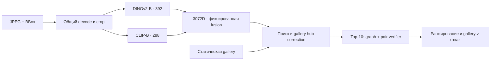

# Falcon ReID

**DeepTech AI · ЛЦТ 2026 · задача №7 «Фалькон Тех»**

Поиск одного автомобиля между камерами с возможностью отказа, когда совпадения
в gallery нет. На входе — JPEG и BBox; на выходе — top-10, эмбеддинги и принятые
кандидаты с confidence. Запуск полностью офлайн в Docker.

**D082:** два визуальных encoder, обученный граф кандидатов и парный verifier.
В matched OOF-сравнении mAP@10 вырос с **84,60% до 85,22%**, Rank-1 — с
**81,60% до 82,34%**. Для ускоренного исходного runtime на RTX A5000 измерены
**121,6–124,0 FPS и p50 38,74–39,95 мс** в extraction-зоне с чтением JPEG.
Границы этих измерений и результаты проверки перенесённого кода приведены
в [протоколе проверки](docs/d082_acceptance.md).

[Архитектура и навигация по коду](docs/architecture.md) ·
[Измерения и воспроизведение](docs/d082_acceptance.md) ·
[Источники весов](docs/sources.md)

## Запуск

Нужны Linux x86-64, NVIDIA GPU, NVIDIA Container Toolkit, Docker с BuildKit
и Compose ≥2.39.4. Версии зависимостей закреплены; CUDA runtime — 12.1.

```bash
git clone https://github.com/Timur713/hf_2026.git
cd hf_2026
# Поместите данные организаторов в dataset/.
mkdir -p outputs
docker compose run --build --rm reid
```

```text
dataset/
├── images/
├── test_query.csv
└── test_gallery.csv
```

Оба CSV: `image_id,x,y,w,h`; координаты в пикселях полного кадра.
Gallery содержит минимум 10 объектов. ID уникальны внутри каждого CSV.
Входы монтируются read-only; число объектов берётся из CSV.

При сборке скачивается фиксированный архив весов с проверкой SHA-256;
при инференсе сеть отключена (`network_mode: none`). Для private Release
предварительно скачайте тот же архив авторизованным GitHub CLI:

```bash
mkdir -p artifacts
gh release download d082-candidate-20261019-r2 --repo Timur713/hf_2026 \
  --pattern falcon-D082-legacy66-base-bundle.tar.gz --dir artifacts
mv artifacts/falcon-D082-legacy66-base-bundle.tar.gz artifacts/d082_production_bundle.tar.gz
docker compose run --build --rm reid
```

Архив: `732784145` байт, SHA-256
`0920e24524e9b32215323bbe3f8e47ae6e19d1f036b14eacfa596507b83d95d5`.
[Версионированный Release](https://github.com/Timur713/hf_2026/releases/tag/d082-candidate-20261019-r2).
Распаковщик отклоняет несовпадение SHA, лишние файлы и ссылки в архиве.
Все веса инференса вместе, включая verifier и graph: **788873516 байт** при лимите 2 ГБ.

Для своих путей создайте выходной каталог и задайте:

```bash
DATA_ROOT=/absolute/path/dataset OUTPUT_ROOT=/absolute/path/results \
  QUERY_CSV=/data/query.csv GALLERY_CSV=/data/gallery.csv \
  docker compose run --rm reid
```

Модель, manifest, порог и коэффициенты зафиксированы в образе. `--log-level`
принимает DEBUG/INFO/WARNING/ERROR; структурированные сообщения, SHA и таймеры
этапов идут в stderr. Повторный запуск перезаписывает выходные файлы.

## Как устроено решение



1. **Представление.** DINOv2-B/14 и CLIP-B/16 дообучены на train; на инференсе
   используются pre-BN features, исходные L2 и фиксированная взвешенная
   конкатенация. Финальные encoder и verifier обучены на всех пяти train-фолдах.
2. **Порядок кандидатов.** Gallery-only hub correction уменьшает влияние
   универсально похожих объектов. Графовая модель использует 13 признаков
   кандидата и связи gallery–gallery внутри top-10. Verifier сравнивает
   изображение query с каждым из этих десяти кандидатов. Graph residual — 0,5,
   вес стандартизированного verifier — 0,15.
3. **Отказ.** Confidence выбранного кандидата стандартизируется по статической
   gallery, порог — 6,6. Confidence является gallery-z, а не вероятностью.
4. **Исполнение.** CPU готовит следующие изображения, пока GPU обрабатывает
   текущую четвёрку. CUDA Graphs сокращают накладные расходы запуска.
   Одиночное изображение передаётся на GPU один раз и дополняется собой в
   прежнем contiguous fixed4 буфере. Ожидания других запросов нет.

В production CLI, одиночном `extract()` и C5-бенчмарке используется один
[D082Extractor](reid/infer/d082_extractor.py). Разрешения, FP16, fixed4, веса и
нормализация при ускорении сохранены; verifier cache и projection precast выключены.

## Результаты и воспроизводимость

| Проверка | Результат | Что измерялось |
|---|---:|---|
| mAP@10 | 84,60% → **85,22%** | Matched OOF, folds 0/1/3/4 |
| Rank-1 | 81,60% → **82,34%** | То же сравнение |
| Rank-5 | 94,95% → 94,92% | Прирост не заявляется |
| Ускоренный D082, RTX A5000 | **121,611–124,040 FPS** | Три C5-повтора, batch=32 |
| Тот же runtime, batch=1 | **p50 38,740–39,950 мс** | 50 warmup / 300 замеров, JPEG→L2 |
| Паритет ускоренного исходного runtime | **Три файла побитно совпали** | 1138 query / 636 gallery, native и ускорение |
| Linux/Python 3.10 QA исходного runtime | **898 passed, 6 skipped** | Реальный D082 smoke проверен отдельно |

OOF-качество относится к независимым development-моделям, а не к финальным
all-data весам. Скорость измерена на A5000 до переноса оптимизации в этот
production-класс; это не замер закрытого теста жюри. В отдельном диагностическом
harness p50 был 41,006–41,321 мс; причина расхождения подготовки процессов
не установлена. Запас худшего C5 — всего 0,05 мс. Все исходные результаты,
включая этот диапазон, сохранены в [отчёте](docs/d082_acceptance.md).

Поиск, graph и verifier не входят в extraction FPS. Полный JPEG→кандидат
измеряется отдельно; 100 FPS полного сервиса здесь не заявляются.
Исторические `submission/`, презентация и видео относятся к D065.
Для D082 три выходных файла формирует текущий код из предоставленных входов.

## Выходные файлы

| Файл | Формат |
|---|---|
| `submission.csv` | Без заголовка: query ID и 10 различных gallery ID |
| `embeddings.npy` | float32 `(N_query + N_gallery, 3072)`, query затем gallery, L2 |
| `candidates.csv` | `query_id,gallery_id,confidence`; три упорядоченных кандидата для принятого query, при отказе строк нет |

## Ограничения задачи

Каждый query использует только себя и неизменную gallery. Нет query expansion,
кластеризации query, нормализации по query-batch и использования `camera_id`
или `vehicle_id` на инференсе. Модели и порог не подбираются по test.
Фиксированная форма GPU forward сохраняет ответ при изменении состава batch;
проверены перестановки, singleton и замена соседей.

Номерные знаки не распознаются. Заливка номерных зон применялась при обучении
и ограниченном контроле, но отсутствие OCR не доказывает независимость от
всех остаточных признаков номера. Объём и ограничения контроля раскрыты
в [протоколе](docs/d082_acceptance.md#качество-отказы-и-номерные-зоны).

## Ответ на обратную связь жюри

| Замечание 16 октября | Изменение и результат |
|---|---|
| Режим отказов | Разобраны ошибки и калибровка. Порог 6,0 не улучшил проверку folds 3/4; сохранён 6,6. Улучшение recall закрытого теста не заявляется |
| Порядок кандидатов | Обученный граф + verifier: в matched OOF Rank-1 +0,74 п.п., mAP@10 +0,62 п.п. |
| Логирование и зависимости | Logging с уровнями, SHA и таймерами; image/torch adapter verifier находится в infer, функции post не выполняют JPEG I/O |
| Скорость и batch=1 | Конвейер CPU/GPU, CUDA Graphs и singleton H2D; запрос обрабатывается сразу. Исходный ускоренный C5 на A5000: 121,6–124 FPS, p50 38,74–39,95 мс |

## Проверка пакета

```bash
# QA-образ содержит Git для тестов; runtime не зависит от Git.
docker build --target qa -t falcon-reid:qa .
docker run --rm --network none --gpus all \
  --mount type=bind,src=/absolute/path/dataset,dst=/data,readonly \
  --entrypoint make falcon-reid:qa check DATA_ROOT=/data
```

Для строгого smoke используйте `make smoke-strict DATA_ROOT=/data` в том же
контейнере. Он требует фактического инференса и проверяет три файла/C6.

C5 текущего production-кода из образа:

```bash
docker compose run --rm --entrypoint python3 reid scripts/bench_final_candidate.py \
  --images /data/images --csv /data/test_query.csv \
  --run-label d082-singleton --json-out /out/c5.json
```

Бенчмарк проверяет SHA исходников и manifest, включает JPEG→L2, использует
медиану 300 измерений после 50 прогревов и batch 1/8/16/32 по ≥10 секунд.
Возврат 0 означает завершение измерения; аппаратный результат находится
в `a5000_target.actual_a5000_target_pass`. H100 не может получить этот A5000 PASS.

## Источники

Исходные pretrained: Meta AI DINOv2-B/S и LAION/OpenCLIP ViT-B/16,
timm-конверсии. Автор дообученных весов и graph — DeepTech AI. Полные сведения,
включая SHA финального архива и правила загрузки: [sources.md](docs/sources.md).

| Автор / модель | Immutable revision URL | Исходный SHA-256 |
|---|---|---|
| Meta AI, DINOv2-B | [4685c99dabffe5affac90bd99dbffd25801ae58d](https://huggingface.co/timm/vit_base_patch14_dinov2.lvd142m/tree/4685c99dabffe5affac90bd99dbffd25801ae58d) | `55cbb5d887b336d430e649c277b85a1429e724871f9d02ac16203235886d8c7b` |
| LAION/OpenCLIP, CLIP-B | [fbadfdd1c0e903c58855b70ae04740b22da9d305](https://huggingface.co/timm/vit_base_patch16_clip_224.laion2b/tree/fbadfdd1c0e903c58855b70ae04740b22da9d305) | `35fcf20089626ce1534aa3d4d8d97a02ca79e171a1735d0c8d58e150eded9ad5` |
| Meta AI, DINOv2-S verifier | [4610ca143709d58a633b6397a74412c2c3842454](https://huggingface.co/timm/vit_small_patch14_dinov2.lvd142m/tree/4610ca143709d58a633b6397a74412c2c3842454) | `04d27f3400d059fc0cfd7d17dd1909a75bf3ea8fb3eeb48b97cb99e57ee20081` |
