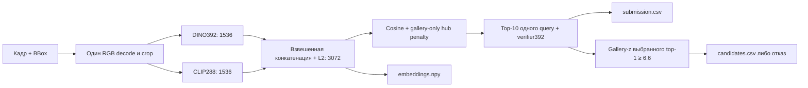

# Falcon Tech Vehicle ReID — DeepTech AI

Офлайн-сервис повторной идентификации автомобиля: полный кадр и BBox → визуальный признак → поиск в статической gallery → кандидаты либо отказ. Решение для задачи №7 ЛЦТ2026. OCR, детекция автомобиля, трекинг и определение владельца не входят в задачу. Визуальное сходство — подсказка оператору, не доказательство нарушения.

## Финальный состав

По **D-065 / A-104** выбран ансамбль **DINO392 + CLIP288**, без SigLIP:

| Компонент | Конфигурация |
|---|---|
| DINOv2 ViT-B/14 | `hires392_all`, 392×392, `cls_top16`, 1536 признаков |
| CLIP ViT-B/16 | `div_clip_all`, 288×288, `cls_top16`, 1536 признаков |
| Объединённый признак | 3072, float32, L2-нормированный |
| Парный verifier | DINOv2 ViT-S/14, input392, all-data `v_fus_all_frz_input392` |
| Поиск | cosine, gallery-only hub penalty, top-10 |
| Re-ranking | standardized, **`rerank_weight=0.15`** |
| Отказ | gallery-z, **`candidate_threshold=6.6`** |
| Общий размер весов | **788 647 632 байта**, лимит 2 000 000 000 |

All-data веса и исходные публичные pretrained URL/revision/SHA переданы A. Политика пары отдельно откалибрована на train folds0/1; порог тройки6.3 сюда не переносится. [Качество](docs/benchmarks/fusion_pair_exact_20260927/README.md), [происхождение весов](docs/benchmarks/final_pair_provenance_20260927/README.md).

Docker/Compose используют пару по умолчанию; одиночный исторический релиз доступен через `--target legacy`. **27.09 канонический `submission/` заменён финальной парой D3072:** четыре полных офлайн-прогона, включая два свежих контейнера со штатной командой, дали одинаковые SHA трёх файлов. [Отчёт, image digest и SHA](docs/benchmarks/final_pair_acceptance_20260927/README.md), [чек-лист](docs/final_delivery_checklist.md), [Docker](docs/fusion_docker.md). Строгая численная проверка разных batch sizes сохранила FAIL по confidence; пределы проверки независимости описаны ниже, а не скрыты общей отметкой PASS.

## Быстрый запуск

Нужны Linux x86-64, NVIDIA GPU, NVIDIA Container Toolkit, Docker/Compose v2. Образ использует CUDA12.1; эталонный GPU — RTX A5000 24ГБ. Сеть нужна только для сборки; инференс выполняется **без сети**.

```bash
git clone https://github.com/Timur713/hf_2026.git
cd hf_2026
# Распакуйте конкурсный датасет в ./dataset.
mkdir -p outputs
docker compose run --build --rm reid
```

Публичная поставка — отдельный чистый снимок, без приватной истории разработки.
Build скачивает фиксированный Release-архив без авторизации; SHA архива и манифеста
остались прежними. Токены не нужны. Неверный существующий кэш останавливает сборку
без скрытого переключения на другие веса. Старые внутренние ссылки в provenance
обозначают происхождение; для запуска нужен только публичный финальный bundle.
Состояние публикации, демонстрация и ссылки для формы — в [материалах сдачи](docs/delivery/README.md).

Compose монтирует `dataset/` read-only в `/data`, `outputs/` в `/out`, задаёт `network_mode: none`. Для других путей:

```bash
DATA_ROOT=/absolute/path/dataset OUTPUT_ROOT=/absolute/path/results \
  QUERY_CSV=/data/query.csv GALLERY_CSV=/data/gallery.csv \
  docker compose run --rm reid
```

Каталоги должны существовать. Выходы перезаписываются кодом: для экспериментов выбирайте новый каталог. Без Docker, после установки проверенного пакета:

```bash
PYTHONPATH=. python -m reid.infer.run \
  --images dataset/images --query dataset/test_query.csv \
  --gallery dataset/test_gallery.csv --out outputs/local \
  --model artifacts/models/fusion \
  --verifier artifacts/models/fusion/verifier.pt --device cuda
```

Загрузка с `pretrained=False`: runtime читает только локальные веса. CPU подходит для проверки механики, не для GPU-норматива. Запуск без verifier — другой алгоритм, не финальная конфигурация.

## Входы и выходы

```text
dataset/
├── images/              # полные JPEG/PNG
├── train.csv            # только обучение и локальная оценка
├── test_query.csv
└── test_gallery.csv
```

CSV инференса: `image_id,x,y,w,h`. BBox в пикселях полного кадра; ID уникальны внутри CSV. Допускается имя с расширением или без. Gallery содержит минимум10 объектов. Размеры вычисляются из входов, числа1110/750 не зашиты. `vehicle_id,camera_id` не принимаются на инференсе.

| Выход | Формат |
|---|---|
| `submission.csv` | Без заголовка: query ID и ровно10 различных gallery ID, все query в порядке входа |
| `embeddings.npy` | float32 `(N_query + N_gallery, 3072)`: сначала query, затем gallery, конечные L2-векторы |
| `candidates.csv` | Заголовок `query_id,gallery_id,confidence`; три строки принятого query, ни одной при отказе |

Confidence верхнего кандидата — gallery-z, **не вероятность**. У второго и третьего — строго убывающие ранговые оценки (D-048), не собственные косинусы. Порог применяется к первому; нижние строки не влияют на текущий evaluator.

BBox обрезается по границам кадра; крошечный/внекадровый положительный BBox даёт минимум1×1px. Это гарантирует формат, не информативность. Битый кадр, дубликат ID, неверные координаты или малая gallery завершают запуск с понятной ошибкой. Неполный вывод после ошибки нельзя сдавать.

## Архитектура и алгоритм



| Ответственность | Код |
|---|---|
| CSV, порядок и запись | `reid/infer/run.py` |
| Decode, признаки, конкатенация | `reid/infer/extractor.py`, `reid/infer/fusion.py` |
| Общая предобработка C3 | `reid/data/preprocess.py` |
| Поиск, gallery-статистики, verifier | `reid/post/` |
| Форматы, all-data metadata, SHA/вес | `reid/eval/validate_outputs.py`, `scripts/audit_release.py` |
| Пакет и строгая установка | `scripts/prepare_fusion_artifact.py`, `scripts/stage_fusion_release.py` |

Полный кадр декодируется один раз. Для каждого компонента: clip BBox, тесный crop (`bbox_pad=0`), stretch до его размера через bilinear `antialias=True`, нормализация из C3 YAML. Нет приближённого DCT/ROI decode. Предобработка распараллелена на8 CPU workers без смены пиксельного контракта.

`cls_top16` объединяет CLS с усреднением16 выбранных patch-токенов; BNNeck в retrieval не применяется (`model.features()`, D-051). CUDA forward — FP16 autocast, выходы — float32. TTA выключен. Коэффициенты конкатенации определяются по стандартному отклонению gallery–gallery cosine и записаны в пакет, без test-query.

Gallery извлекается один раз. Штраф за хабность и шкала confidence вычисляются только по gallery. Verifier меняет порядок внутри исходной десятки одного запроса:

```text
rerank_score = standardized_retrieval_score + 0.15 × sigmoid(verifier_logit)
```

Для фактически выбранного top-1 считается gallery-z: ниже6.6 — отказ. Нет query expansion, кластеризации запросов, camera_id и общей нормализации query. Модели в `eval()`, L2 по каждому вектору. GPU batch-shape rounding проверяется отдельно от запрещённого обмена информацией между query; побитовое равенство разных batch shapes не предполагается.

Фильтр двойников выключен (D-023/D-024): same-vehicle/same-camera кадр удаляется evaluator при retrieval, но является правильным совпадением в режиме кандидатов. k-reciprocal исследован и отвергнут (A-010).

## Обучение и честная оценка

Train:9556 кадров,1541 автомобиль. Пять фолдов по `vehicle_id`, seed2026, сохранены в `splits/`. Gallery содержит по кадру на пару автомобиль–камера; около20% query без пары. `camera_id` применяется только в sampling, фолдах и junk-фильтре оценки.

Оба финальных эмбеддера обучены на всех пяти фолдах:100 эпох, AdamW, CE label smoothing0.1 + triplet margin0.3, PK16×4, LR backbone1e-5/головы1e-3, LLRD0.75, weight decay0.05, warmup3. BBox/color jitter, erasing0.7, геометрическая заливка номерной области0.5. Точные параметры, training commit `b2823b0` и source hashes — в C3 YAML. Verifier: замороженный DINOv2-S,4000 шагов головы,input392,plate_band_p0.5 (A-102).

Повторение: `scripts/train.py`, `scripts/train_verifier.py`, `configs/vitb14_224.yaml` с параметрами C3 YAML. Исходные публичные веса нужны при обучении, не в runtime. Фолды не пересоздавать; повторное обучение на другом оборудовании не обещает идентичных байтов. [Эксперименты](EXPERIMENTS.md) и [решения](DECISIONS.md) фиксируют отбор.

| Пара: matched C4 replay | Fold0 | Fold1 | Среднее |
|---|---:|---:|---:|
| mAP@10 без verifier | 0.861191 | 0.837467 | 0.849329 |
| mAP@10, verifier0.15 | **0.867501** | **0.837581** | **0.852541** |
| CandidateScore, threshold6.6 | 0.964296 | 0.956645 | **0.960470** |

Источник — [A-104](docs/benchmarks/fusion_pair_exact_20260927/README.md), точные production top-10 окна и независимые OOF verifier. **B независимо воспроизвёл оба фолда на Linux/x86** с исходными логитами без изменения окон: [аудит](docs/benchmarks/final_pair_replay_b_20260927/README.md). Метрики через `reid/eval/eval_local.py`; junk удаляется до top-10 **без добора**. Порог6.6 выбран по среднему `0.7×F1+0.3×TNR`, устойчивая область6.5–6.65. Test не используется для настройки.

Это **два OOF-фолда и C4-дампы**, не OOF5, не закрытый тест и не качество all-data на train. У all-data моделей нет честной отложенной оценки на обучающих фолдах. Ранее обнаружена разница JPEG-cache и full-frame пути: не переносим C4 число в «качество Docker» без отдельного замера. [Контроль cache/precision](docs/benchmarks/c3_precision_cache_20260927/README.md). Исторические ≈0.784 и результаты тройки — другие составы.

## Скорость и приёмка

Прямой замер пары на **1×RTX A5000,R535.54.03,8vCPU**: **24.884мс batch1,102.674FPS**, peak allocated VRAM эмбеддеров около1313MiB. [Отчёты](docs/benchmarks/fusion_a5000_20260927/README.md). Нормативы40мс/100FPS; запас по throughput небольшой. Это C5 Extractor на тех же all-data весах, не весь verifier-пайплайн и не CPU стенда жюри. Тройка дала79.59–82.16FPS; выбор основан на замере, не прогнозе112FPS.

Таймер C5: диск→decode→crop→resize→forward→L2. Загрузка, поиск и verifier вне `extract()`, но входят в общий запуск. Протокол:50 прогревов,300 синхронизированных batch1 замеров,≥10сек для batches1/8/16/32.

Финальный self-contained image на **A10/R615**: **24.415мс/107.288FPS**,
extractor1313MiB; весь pipeline с verifier127.768/121.619с,
peak allocated1436.692MiB. Это отдельный замер A10, не замена A5000.
Внутри `--network none`:482tests+3host-Gitskips, настоящий smoke50,C6,
all-data/weight audit, masked-control; локально493tests+smoke50.
[Полные receipts](docs/benchmarks/final_pair_acceptance_20260927/README.md).

GPU-проверка замены24 соседей у8 фиксированных query в batch32 и перестановки
прошла **побитово**, включая эмбеддинги. Отдельный batch1/batched тест на24query
сохранил top10/кандидатов/отказы, но confidence отличается до0.000393:
**strict numeric FAIL сохранён**, без округления или ослабления проверки.
Код не использует информацию других query; универсальное побитовое равенство
между разными batch shapes не заявляется. Два одинаковых полных запуска и
два свежих штатных контейнера при этом дают одни и те же три файла (D-067).

```bash
make check PYTHON=python
make smoke-strict PYTHON=python
PYTHONPATH=. python scripts/bench_extract.py --model artifacts/models/fusion \
  --images dataset/images --csv splits/fold0_query.csv --device cuda:0 \
  --require-cuda --warmup 50 --iterations 300 --batch-sizes 1,8,16,32 \
  --throughput-seconds 10 --json-out outputs/bench.json
```

`make check`: C6 self-test, pytest, smoke50. Финальная приёмка требует отсутствие source/model bind mounts, `--network none`, all-data gate, два полных прогона с SHA трёх файлов, query-independence и train-only masked-control. [Команды](docs/fusion_docker.md), [статус](docs/final_delivery_checklist.md). На test только прогон и проверка формата, без анализа ошибок и подбора.

Masked-control заливает одинаковую область до предобработки эмбеддеров и verifier; исходники не меняются. **Геометрическая маска не гарантирует попадание в настоящий номер**: [train QA](docs/benchmarks/train_plate_mask_qa_20260927/README.md) нашла промахи. Технический PASS не доказывает plate-invariance; нужен контроль с точными номерными зонами.

## Источники и лицензии

Автор дообученных весов — DeepTech AI. Финальные файлы распространяются вместе
в [публичном pair bundle](https://github.com/Timur713/hf_2026/releases/tag/fusion-pair-d065-20260927-rc1).
Исторический исходный `fusion-all-v1` — в приватном архиве разработки, для
запуска он не нужен. SHA отдельных файлов:

| Файл | SHA-256 |
|---|---|
| `hires392_all.safetensors` | `f69eb2283c03a2748ac44cb4e1a4902bbc6f3129440cf3799edafa0f0ea0aaeb` |
| `div_clip_all.safetensors` | `6157e1eb862a0c88f637ed2a163bf6bbbe52459a88d41f3b623e83e69180548f` |
| `v_fus_all_frz_input392.pt` | `aa254e396ac0be78d29f32641e83f8d18e165d76eb3345c18c1054d105b9abf5` |

Исходные pretrained (Apache-2.0, timm conversion):

| Автор / модель | Immutable revision URL | Исходный SHA-256 |
|---|---|---|
| Meta AI, DINOv2-B | [4685c99dabffe5affac90bd99dbffd25801ae58d](https://huggingface.co/timm/vit_base_patch14_dinov2.lvd142m/tree/4685c99dabffe5affac90bd99dbffd25801ae58d) | `55cbb5d887b336d430e649c277b85a1429e724871f9d02ac16203235886d8c7b` |
| LAION/OpenCLIP, CLIP-B | [fbadfdd1c0e903c58855b70ae04740b22da9d305](https://huggingface.co/timm/vit_base_patch16_clip_224.laion2b/tree/fbadfdd1c0e903c58855b70ae04740b22da9d305) | `35fcf20089626ce1534aa3d4d8d97a02ca79e171a1735d0c8d58e150eded9ad5` |
| Meta AI, DINOv2-S verifier | [4610ca143709d58a633b6397a74412c2c3842454](https://huggingface.co/timm/vit_small_patch14_dinov2.lvd142m/tree/4610ca143709d58a633b6397a74412c2c3842454) | `04d27f3400d059fc0cfd7d17dd1909a75bf3ea8fb3eeb48b97cb99e57ee20081` |

Прямые ссылки на байты, размеры, авторы — [source_models.json](docs/benchmarks/final_pair_provenance_20260927/source_models.json). `scripts/analysis/verify_model_provenance.py` сверяет HF revision/LFS metadata; `--download` хеширует байты. Исходный pretrain SHA отличается от обученного checkpoint SHA. Verifier sidecar входит в манифест пакета.

Прямые и транзитивные runtime-зависимости точно закреплены в [requirements-lock-cu121.txt](requirements-lock-cu121.txt), CUDA base — digest в Dockerfile. Основные: PyTorch2.5.1+cu121, torchvision0.20.1, timm1.0.15, numpy1.26.4, pandas2.2.3, Pillow11.3.0, safetensors0.5.3, huggingface_hub0.30.2, PyYAML6.0.2. FAISS1.9.0 — только ANN-анализ, не runtime.

Основной dataset — организаторы ЛЦТ2026, «Фалькон Тех». [VeRi-776](https://github.com/VehicleReId/VeRidataset) (Xinchen Liu и соавторы) и [VehicleID](https://www.pkuml.org/resources/pku-vehicleid.html) (PKU,CVPR2016) исследованы, но не вошли в финальное обучение пары. Данные имеют отдельные условия доступа и не распространяются в образе. VERI-Wild,DINOv3,fast-reid,SigLIP не входят в финальный инференс.

## Ошибки, масштабирование, ограничения

[Описание ошибок](docs/errors/README.md), [top-1](docs/errors/top1_errors.jpg), [patch correspondence](docs/errors/interpretability.jpg) — train/валидация, не test. Одинаковые машины одного цвета, такси/каршеринг, смена ракурса, ночь и перекрытия остаются главными причинами ошибок. Мелкие повреждения теряются при resize. Исторические иллюстрации относятся к указанным экспериментам, не автоматически к финальной паре.

Для маленькой gallery — точный поиск. [ANN на синтетической gallery10⁶](docs/ann_scale.md):1536-мерные признаки, exact421мс против IVF-Flat2.75мс, recall@10=1.000; IVF-SQ8 вчетверо компактнее при recall0.980. Это не замер пары3072 на миллионе реальных машин. Для масштабирования нужны кэш gallery, ANN top-K и отдельная проверка потери конечного качества.

Open-set риск: когда cross-camera позитивов нет, но same-camera двойник остался, confidence может быть завышен (D-050,A-046). Три запасных кандидата риск не устраняют. Отсутствие OCR не доказывает нулевого влияния номерной зоны. Выдача требует проверки человеком; итоговые баллы определяет закрытый прогон организаторов.

## Навигация

[ТЗ](MainTechSpec.md) · [План](PLAN.md) · [Контракты](docs/contracts.md) · [Эксперименты](EXPERIMENTS.md) · [Решения](DECISIONS.md) · [GPU-замеры](docs/speed_table.md) · [Чек-лист](docs/final_delivery_checklist.md). Поздние D-023/D-048 уточняют историческую фразу C6: код не фильтрует двойников.
